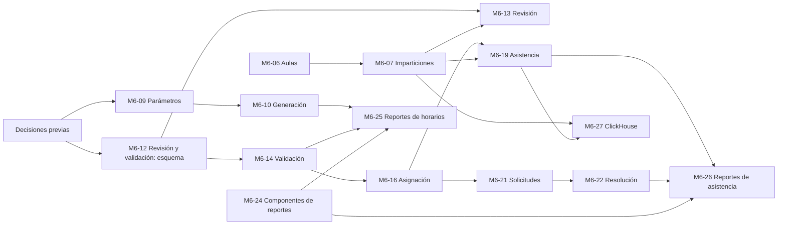

# Plan de M6

Propuesta de la issue #69 para convertir la revisión de M5 en un plan de ejecución de M6. Parte de la [revisión de cobertura](../revisiones/cobertura-diseno-m5.md) (#68) y de las [reglas de negocio propuestas](../reglas/reglas-negocio-m6.md) (#71).

**Estado: propuesta.** Las prioridades, estimaciones y responsables se deben acordar en equipo. Las issues de GitHub se crearán después de ese acuerdo, con el texto de la sección 4.

**Aviso de actualización:** este plan conserva la propuesta hecha sobre la versión indicada abajo y todavía no incorpora los acuerdos posteriores de [identidad y permisos](../reglas/identidad-y-permisos-m6.md), las [reglas de horarios revisadas](../reglas/reglas-negocio-m6.md) ni el cierre de #66. Sus referencias a P1–P14, al horario manual y al orden de revisión y validación están desactualizadas. Las estimaciones, dependencias, prioridades y tareas deben rehacerse en #69; no utilizar la sección 4 como contrato definitivo.

## 1. Punto de partida

| Dato                       | Valor                                                                                                                                                                  |
| -------------------------- | ---------------------------------------------------------------------------------------------------------------------------------------------------------------------- |
| Código                     | `develop` en `0b792c9` (fusión del PR #75)                                                                                                                             |
| Pendiente según el diseño  | 29 RF pendientes, 5 parciales y 1 solo en esquema; 6 de las 8 RII; RNF01 y RNF02                                                                                       |
| Alcance del hito M6        | Generación automática, imparticiones y aulas, revisión y validación, asignación, asistencia, solicitudes de cambio, reportes con PDF y almacén analítico en ClickHouse |
| Fecha del hito M6 (GitHub) | 2026-11-10, **ya vencida**. M7 (2026-11-17) y M8 (2026-11-24) también                                                                                                  |
| Pendientes de M4           | #65 resuelta (PR #72). #66 (bajas) en curso                                                                                                                            |
| Decisiones abiertas        | #67 (identidad y permisos) y P1–P14 de #71                                                                                                                             |

### Ritmo de M4 como referencia

M4 empezó el 2026-10-12 con fecha prevista el 2026-10-27. La verificación del recorrido completo (#40) se cerró el 2026-11-24: **seis semanas en lugar de dos**. M4 cubrió 11 RF completos. M6 tiene unos 30 RF pendientes, la mayoría con reglas más complejas (concurrencia, transacciones de varias tablas, un algoritmo de búsqueda y un segundo motor de base de datos).

## 2. Decisiones previas

El camino crítico no puede empezar sin estas decisiones. Propuesta: cerrarlas en una sola reunión antes de crear las issues.

| Decisión                                                      | Origen    | Bloquea                     |
| ------------------------------------------------------------- | --------- | --------------------------- |
| P5–P8 y P13: parámetros de generación y origen del horario    | #71       | M6-09, M6-10                |
| P1–P4 y P14: orden de revisión y validación y quién participa | #71       | M6-12 a M6-15               |
| P9: zona horaria de las reglas por fecha                      | #71       | M6-03                       |
| P10–P12: cupo, formato del período y quién asigna             | #71       | M6-16                       |
| Dominio de `periodoImp` y representación de intervalos        | D4, D9    | M6-07                       |
| Identidad y matriz de permisos                                | #67, D15  | M6-05 y los filtros por rol |
| ESQUEMA_LLAVE como tabla física o relación teórica            | D6        | M6-12                       |
| Perfiles disjuntos también en la base de datos                | D11       | M6-02                       |
| Calendario real de M6 a M8                                    | Riesgo R1 | Todo el plan                |

## 3. Issues propuestas

Tamaños en jornadas de trabajo de una persona: S = 1, M = 2–3, L = 4–5. Prioridad 1 es el camino crítico del flujo de un horario; 2 completa el alcance de M6; 3 se puede recortar o retrasar sin romper el flujo.

| Id    | Issue                                                      | Requisitos                     | Depende de                        | Tamaño | Jornadas | Prioridad |
| ----- | ---------------------------------------------------------- | ------------------------------ | --------------------------------- | ------ | -------: | --------: |
| M6-01 | Proteger RII01 y el alta de FECHA ante concurrencia        | D8, D10                        | —                                 | S      |        1 |         2 |
| M6-02 | Completar pruebas de API y corregir documentación          | D11, D12, D13                  | Decisión D11                      | S      |        1 |         3 |
| M6-03 | Aplicar la zona horaria institucional                      | F01, RII01                     | P9                                | S      |        1 |         3 |
| M6-04 | Ampliar los datos de demostración para M6                  | —                              | Se completa al final              | M      |        2 |         3 |
| M6-05 | Implementar identidad y permisos                           | RF09, RF26, RF29, RF45         | #67                               | L      |        4 |         2 |
| M6-06 | Catálogo de aulas                                          | RI16                           | —                                 | S      |        1 |         1 |
| M6-07 | Programar imparticiones e impedir solapamientos de aula    | RF16, RF17, RI14, RII04        | M6-06, D4/D9                      | L      |        4 |         1 |
| M6-08 | Consultar disponibilidad y ocupación                       | RF27, RNF01                    | M6-07                             | M      |        3 |         3 |
| M6-09 | Esquema de los parámetros de generación                    | RI13, D2, D3                   | P5–P8, P13                        | S      |        1 |         1 |
| M6-10 | Generación automática de horarios                          | RF12–RF14                      | M6-09                             | L      |        5 |         1 |
| M6-11 | Pantalla de generación                                     | RF12, RF13                     | Contrato de M6-10                 | M      |        2 |         2 |
| M6-12 | REVISION, VALIDACION y transiciones de estado              | RI17–RI20, D5, D6              | P1–P4, P14                        | M      |        2 |         1 |
| M6-13 | Revisión del jefe de departamento y regeneración           | RF18–RF20, RF22                | M6-12, M6-07                      | M      |        3 |         1 |
| M6-14 | Validación por coordinadores                               | RF21, RF22, RII02              | M6-12                             | M      |        2 |         1 |
| M6-15 | Pantallas de revisión y validación                         | RF18–RF22                      | Contratos de M6-13 y M6-14        | M      |        3 |         2 |
| M6-16 | Asignar horarios a estudiantes                             | RF23, RF24, RI21, RII08, § 7.4 | M6-14, P10–P12                    | M      |        3 |         1 |
| M6-17 | Consultas de horarios de estudiantes y coordinadores       | RF25, RF26, RI22–RI24          | M6-16; M6-05 para filtrar por rol | S      |        1 |         2 |
| M6-18 | Pantallas de asignación y consulta                         | RF23–RF26                      | Contratos de M6-16 y M6-17        | M      |        2 |         2 |
| M6-19 | Registro de asistencia                                     | RF28, RI25, RI27, RII05        | M6-07, M6-16                      | M      |        3 |         2 |
| M6-20 | Consulta de asistencia y su pantalla                       | RF29, RI26                     | M6-19; M6-05 para los permisos    | M      |        2 |         3 |
| M6-21 | Crear y consultar solicitudes de cambio                    | RF30, RF31, RF34, RI28, RII06  | M6-16                             | M      |        2 |         2 |
| M6-22 | Resolver solicitudes de cambio                             | RF32, RF33, RI29–RI31, RII07   | M6-21                             | L      |        4 |         2 |
| M6-23 | Pantallas de solicitudes de cambio                         | RF30–RF34                      | Contratos de M6-21 y M6-22        | M      |        3 |         3 |
| M6-24 | Componentes de reportes: tablas ordenables, gráficos y PDF | RF43–RF45, RI40                | —                                 | M      |        3 |         2 |
| M6-25 | Reportes de horarios                                       | RF35–RF37, RF39, RI32–RI34     | M6-10, M6-14, M6-24               | M      |        3 |         2 |
| M6-26 | Reportes de asistencia                                     | RF38, RF40–RF42, RI35–RI39     | M6-19, M6-22, M6-24               | L      |        4 |         3 |
| M6-27 | Almacén analítico en ClickHouse y sincronización           | RF46, RI41, RNF02, § 7.4       | Fuentes: M6-07 y M6-19            | L      |        5 |         2 |
|       | **Total**                                                  |                                |                                   |        |   **70** |           |

### Dependencias

### Camino crítico y trabajo en paralelo

El camino más largo es M6-12 → M6-14 → M6-16 → M6-21 → M6-22 → M6-26. Suma unas **17 jornadas seguidas** aunque el resto del equipo trabaje en paralelo: con dedicación completa son tres semanas y media, y más con dedicación parcial. Las ramas de imparticiones (M6-06 → M6-07 → M6-13) y de generación (M6-09 → M6-10) son más cortas y van en paralelo.

Para acortarlo:

- **M6-13 y M6-14 van a la vez.** La validación se prueba con horarios ya aprobados en los datos de prueba, sin esperar a la pantalla ni al flujo de revisión.
- **M6-13 no espera a la generación.** La regeneración enlaza la revisión con el horario nuevo (RF20). Se puede probar con un horario armado a mano y conectar M6-10 cuando esté lista.
- **Las pantallas no esperan a la implementación.** Si el contrato de cada endpoint se acuerda al empezar la issue de backend, M6-11, M6-15, M6-18 y M6-23 avanzan en paralelo con datos simulados, como en M4.
- **Los reportes no esperan a ClickHouse.** M6-25 y M6-26 consultan PostgreSQL. M6-27 solo sincroniza, y los reportes pueden pasar a leer de ClickHouse después si da tiempo.

Pueden empezar ya, sin esperar a ninguna decisión: M6-01, M6-06, M6-24 y el diseño del esquema de M6-27.

## 4. Alcance y criterios de cada issue

Cada issue de GitHub incluirá su objetivo, estos criterios y la documentación de cierre. Todas exigen pruebas en las capas que toquen, actualizar el contrato de la API cuando cambien endpoints y dejar `develop` compilando con las pruebas en verde.

### Transversales

**M6-01 Proteger RII01 y el alta de FECHA ante concurrencia.**

- [ ] Prueba con dos conexiones que revoca una autorización mientras se crea un horario (D8). Si se reproduce la carrera, bloquear la autorización como en la migración `Rii03Concurrencia`.
- [ ] Alta de FECHA con `INSERT … ON CONFLICT DO NOTHING` y prueba de dos altas simultáneas de la misma fecha (D10).

**M6-02 Completar pruebas de API y corregir documentación.**

- [ ] Pruebas de endpoints para personas, autorizaciones, programas y asignaturas (D12).
- [ ] Corregir la sección final de `docs/api/contrato-api.md` y el comentario de `listarMatriculas` (D13).
- [ ] Si el equipo decide que los perfiles son disjuntos, protegerlo también en la base de datos (D11).

**M6-03 Aplicar la zona horaria institucional.**

- [ ] Las reglas por fecha (RII01, RII02, vigencias de asignación) usan la fecha de la zona configurada, por defecto `America/Havana` (F01).
- [ ] Pruebas con un reloj fijo a las 23:00 locales, cuando ya es el día siguiente en UTC.

**M6-04 Ampliar los datos de demostración para M6.**

- [ ] `scripts/demo/cargar-datos-demo.mjs` carga aulas, imparticiones completas, horarios en todos los estados que se usen, asignaciones, asistencia y solicitudes.
- [ ] Hay datos suficientes para que todos los reportes devuelvan resultados no vacíos.
- [ ] Guion de demostración de M6, como `docs/demos/demo-m4.md`.

**M6-05 Implementar identidad y permisos.**

- [ ] Mecanismo de identidad acordado en #67, enlazado con PERSONA y su perfil.
- [ ] La API aplica la matriz de permisos de #67 en los endpoints existentes y en los de M6.
- [ ] RF09: solo el creador modifica la clasificación de sus bloques.
- [ ] Pruebas de acceso permitido y denegado por perfil.

El tamaño es provisional hasta cerrar #67.

### A. Imparticiones y aulas

**M6-06 Catálogo de aulas.**

- [ ] Alta, edición y listado de aulas con capacidad positiva (`CK_AULA_CapacidadPositiva`).
- [ ] Pantalla de aulas.

**M6-07 Programar imparticiones e impedir solapamientos de aula.**

- [ ] Completar hora de inicio, hora de fin, período y aula de cada impartición, todos a la vez (D4).
- [ ] Restricción `EXCLUDE` con `btree_gist` sobre aula, fecha e intervalo semiabierto, que admite intervalos contiguos (RII04, D9).
- [ ] Prueba con dos conexiones que intentan solapar la misma aula.
- [ ] Rechazo con código y mensaje propios, documentado en el contrato.

**M6-08 Consultar disponibilidad y ocupación.**

- [ ] Ocupación de un aula por fecha y franja, y huecos libres de un horario (RF27).
- [ ] Índices de apoyo y medición documentada del tiempo de respuesta con los datos de demostración (RNF01: menos de 1 s).
- [ ] Caché en memoria solo si la medición la justifica.

### B. Generación automática

**M6-09 Esquema de los parámetros de generación.**

- [ ] Migración con los cambios de la sección 7 de las reglas: `cantTotalBloques`, CHECK de dominio y de "todos o ninguno".
- [ ] Revisar los datos existentes antes de añadir los CHECK.

**M6-10 Generación automática de horarios.**

- [ ] Algoritmo de las reglas G01–G25 en el dominio, determinista.
- [ ] Endpoint que valida la autorización (RII01), comprueba las precondiciones y guarda el horario con sus parámetros en una transacción.
- [ ] Los códigos `GENERACION_*` de la sección 2.4 de las reglas, sin persistir nada al fallar.
- [ ] Los ejemplos E01–E08 de las reglas como pruebas automáticas.
- [ ] Límite de tamaño o de tiempo para la búsqueda, documentado (riesgo R4).

**M6-11 Pantalla de generación.**

- [ ] Formulario con los criterios de RF12 y vista previa del resultado.
- [ ] Mensaje claro para cada código de rechazo.

### C. Revisión y validación

**M6-12 REVISION, VALIDACION y transiciones de estado.**

- [ ] Tablas REVISION y VALIDACION según 7.2.18 y 7.2.19, con las restricciones de la sección 7 de las reglas.
- [ ] Clave foránea de `HORARIO.idRevisionOrigen` (D5) y las de ESQUEMA_LLAVE si se mantiene como tabla (D6).
- [ ] Máquina de estados del dominio con las transiciones C01–C19, probada transición por transición.

**M6-13 Revisión del jefe de departamento y regeneración.**

- [ ] El jefe aprueba o pide regenerar con observaciones y criterios (RF18, RF19).
- [ ] El horario regenerado queda enlazado a la revisión de origen y el anterior pasa a `RECHAZADO` (RF20).
- [ ] No se envía a revisión un horario con imparticiones incompletas (C01).

**M6-14 Validación por coordinadores.**

- [ ] Validación con autorización vigente y `puedeValidar` en la fecha de validación (RII02), protegida ante concurrencia igual que RII01.
- [ ] Guarda autorización, fecha y observaciones (RF21).

**M6-15 Pantallas de revisión y validación.**

- [ ] Bandeja de horarios pendientes por estado, con detalle e historial de revisiones y validaciones.
- [ ] Acciones de aprobar, pedir regeneración y validar, con sus errores.

### D. Asignación a estudiantes

**M6-16 Asignar horarios a estudiantes.**

- [ ] Tabla HORARIO_ESTUDIANTE según 7.2.16.
- [ ] Solo se asignan horarios validados a estudiantes matriculados en el programa (A01–A05).
- [ ] RII08 protegido ante concurrencia, con prueba de dos conexiones (A06).
- [ ] Cupo por capacidad del aula, si se acuerda P10 (sección 7.4 del diseño, A14).

**M6-17 Consultas de horarios de estudiantes y coordinadores.**

- [ ] El estudiante consulta sus horarios asignados por programa (RF25).
- [ ] El coordinador consulta los horarios de los programas que atiende (RF26), filtrados por identidad cuando exista M6-05.

**M6-18 Pantallas de asignación y consulta.**

- [ ] Asignación de un horario a uno o varios estudiantes, con los rechazos visibles.
- [ ] Vista del horario asignado del estudiante.

### E. Asistencia

**M6-19 Registro de asistencia.**

- [ ] Tabla ASISTENCIA y dominio `estadoAsistencia` (sección 7.1 del diseño).
- [ ] Solo para imparticiones existentes y estudiantes con asignación vigente en esa fecha (RII05).
- [ ] La falta de registro no cuenta como inasistencia (RI27).

**M6-20 Consulta de asistencia y su pantalla.**

- [ ] Consulta por estudiante, horario y bloque (RF29), con los permisos de #67.
- [ ] Pantalla de registro y consulta.

### F. Solicitudes de cambio

**M6-21 Crear y consultar solicitudes de cambio.**

- [ ] Tabla SOLICITUD_CAMBIO según 7.2.20 y dominio `estadoSolicitud`.
- [ ] Solo sobre un horario asignado al estudiante en la fecha de la solicitud (RII06), con coordinador de apoyo opcional (RF31).
- [ ] El estudiante consulta el estado y el resultado de sus solicitudes (RF34).

**M6-22 Resolver solicitudes de cambio.**

- [ ] El coordinador resuelve con estado, fecha y resultado (RF32), con el CHECK de "pendiente sin fecha de resolución".
- [ ] Al aprobar, cierra la asignación anterior y crea la nueva en una sola transacción, comprobando RII08 (RII07, RF33).
- [ ] Pruebas de fallo a mitad de la transacción y de dos resoluciones simultáneas.

**M6-23 Pantallas de solicitudes de cambio.**

- [ ] Formulario del estudiante, bandeja del coordinador y detalle con el horario original y el resultante.

### G. Consultas y reportes

**M6-24 Componentes de reportes.**

- [ ] Tabla con orden por cualquier columna (RF44), reutilizable en las pantallas existentes.
- [ ] Componente de gráfico (RF43) y exportación a PDF de lo que se muestra (RF45).

**M6-25 Reportes de horarios.**

- [ ] RF35 (horarios automáticos con creador y parámetros), RF36 (bloques más impartidos), RF37 (validados por coordinador) y RF39 (comparación entre programas).
- [ ] Cada consulta con su prueba sobre datos conocidos.

**M6-26 Reportes de asistencia.**

- [ ] RF38 (desempeño por complejidad), RF40 (correlación complejidad–asistencia), RF41 (10 bloques con más inasistencia) y RF42 (estudiantes con solicitudes frente a su grupo).
- [ ] Definición escrita de cada tasa y de cómo se tratan los registros que faltan (RI27).

### H. Almacén analítico

**M6-27 Almacén analítico en ClickHouse y sincronización.**

- [ ] Esquema columnar de ocupación de aulas y asistencia por franja, edificio y período (RI41).
- [ ] Proceso periódico idempotente: reprocesar un período no duplica filas y se registra la última actualización (sección 7.4).
- [ ] Prueba de la sincronización con los datos de demostración.

## 5. Riesgos

| Id  | Riesgo                                                                                                                                                     | Respuesta propuesta                                                                                                    |
| --- | ---------------------------------------------------------------------------------------------------------------------------------------------------------- | ---------------------------------------------------------------------------------------------------------------------- |
| R1  | Las fechas de M6, M7 y M8 en GitHub ya vencieron. No consta el calendario real de entrega.                                                                 | Confirmar con el profesor las fechas reales y actualizar los hitos antes de repartir.                                  |
| R2  | M6 tiene unas 70 jornadas de trabajo y un camino crítico de unas 17. M4, con mucho menos alcance, tardó cuatro semanas más de lo previsto.                 | Ejecutar por prioridades: terminar la prioridad 1 antes de abrir la 3. Decidir pronto qué se recorta si no hay tiempo. |
| R3  | Las decisiones abiertas (#67, P1–P14, D4/D9) bloquean todo el camino crítico.                                                                              | Cerrarlas en una sola reunión (sección 2).                                                                             |
| R4  | La generación exige búsqueda completa (G15). En el peor caso crece de forma exponencial con el número de bloques candidatos.                               | Poda por tipo y asignatura, límite de tiempo y prueba con el mayor caso realista.                                      |
| R5  | RII04, RII07 y RII08 requieren protección ante concurrencia, como RII03 en #54.                                                                            | Protegerlas en PostgreSQL (`EXCLUDE`, bloqueos o disparadores) y probarlas con dos conexiones.                         |
| R6  | ClickHouse es un motor nuevo para el equipo y todavía no recibe datos.                                                                                     | Aislarlo en M6-27 y no hacer depender los reportes de él.                                                              |
| R7  | El alcance de la identidad (#67) es desconocido y toca todos los endpoints.                                                                                | Acotar en #67 un mecanismo mínimo que baste para la evaluación.                                                        |
| R8  | El trabajo de M4 se concentró en pocas personas. Si una sola persona lleva varias issues seguidas del camino crítico, cualquier retraso suyo para todo M6. | Repartir el camino crítico entre varias personas y acordar los contratos de API al empezar cada issue de backend.      |

## 6. Reparto sugerido

**Es solo una sugerencia** basada en lo que hizo cada persona en M4. El reparto final se decide en equipo.

| Persona                 | Issues                                   | Jornadas | Afinidad en M4                            |
| ----------------------- | ---------------------------------------- | -------: | ----------------------------------------- |
| Marlon Cuellar          | M6-05, M6-12, M6-13, M6-14, M6-19        |       14 | Horarios (#36), identidad (#67)           |
| Raciel Pupo Santos      | M6-01, M6-02, M6-16, M6-17, M6-21, M6-22 |       12 | Matrículas (#37), concurrencia (#53, #54) |
| Ramón Hernández Camacho | M6-03, M6-04, M6-06, M6-07, M6-09, M6-10 |       14 | Bloques (#38, #41)                        |
| Charly Blanco           | M6-11, M6-15, M6-18, M6-20, M6-23        |       12 | Vistas funcionales (#18)                  |
| Leandro Marquez         | M6-08, M6-24, M6-25, M6-26               |       13 | Diseño del frontend (#19, #59)            |
| Sin asignar             | M6-27                                    |        5 | —                                         |

## 7. Pasos para cerrar #69

1. Reunión de equipo: confirmar el calendario (R1), cerrar las decisiones de la sección 2 y acordar prioridades, estimaciones y responsables.
2. Actualizar este documento con lo acordado y quitar la marca de propuesta.
3. Crear las issues de M6 con los criterios de la sección 4, en el hito M6 y en el tablero, con su responsable y sus dependencias enlazadas.
4. Enlazar desde aquí cada issue creada y cerrar #69.
